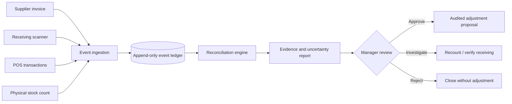

# Retail Commander

**An event-driven, human-in-the-loop inventory reconciliation assistant for retail operations.**

> **Status: Architecture and test specifications published; implementation not yet started.** This repository documents a proposed MVP, not a deployed product or validated performance claim.

## The problem

Retail inventory data can disagree across supplier invoices, handheld receiving scanners, point-of-sale (POS) systems, and physical counts. Offline devices, delayed events, and inconsistent baselines can make a bookkeeping mismatch look like missing merchandise.

Retail Commander aims to explain *what is known, what is uncertain, and what a manager should verify next* before anyone adjusts stock or alleges theft.

## MVP vertical slice

1. Ingest synthetic supplier, receiving, POS, and stock-count events.
2. Deduplicate events and preserve source provenance.
3. Reconcile expected inventory against verified movements and physical counts.
4. Surface evidence, uncertainty, and suggested investigations.
5. Require explicit human approval for any proposed inventory adjustment.

**Out of scope:** production POS integrations, autonomous stock corrections, theft detection, and claims of AI-generated root causes without evidence.

## Architecture

See [Architecture](ARCHITECTURE.md), [System diagram](docs/system-design.md), [Data contracts](docs/data-contracts.md), and [Test scenarios](docs/test-scenarios.md).

## Example: an ambiguous shortage

- Invoice: **200** units.
- Confirmed receiving scans: **180** units.
- POS sales: **15** units.
- Reported shortage: **35** units.

These values alone do **not** establish 35 missing physical units. If a report compared 200 invoiced against 165 (= 180 - 15) net recorded units, it may be mixing incompatible baselines. The actual physical count, opening balance, receipt completion, and stock allocation remain unknown. The correct output is **NEEDS_RECONCILIATION**, not a theft accusation.

## Success criteria (targets, not measured results)

- Duplicate replay does not create duplicate postings.
- Reconciliation is deterministic for the same normalized event set.
- Missing or ambiguous evidence produces an explicit uncertainty state.
- No adjustment is posted without recorded manager approval.
- Every discrepancy report links to the underlying source events.

## Proposed development with Devin

I plan to evaluate Devin as an engineering assistant for implementing this MVP, including event ingestion, reconciliation logic, tests, and a manager-review interface. This repository is a public design commitment and does **not** imply Devin has already produced code.

See [Implementation roadmap](docs/implementation-roadmap.md) for proposed milestones and evaluation metrics.

## Repository map

| File | Purpose |
| --- | --- |
| `ARCHITECTURE.md` | Decisions, invariants, failure handling, and boundaries |
| `docs/system-design.md` | Mermaid component and sequence diagrams |
| `docs/data-contracts.md` | Proposed event schema and reconciliation outputs |
| `docs/test-scenarios.md` | Test cases and expected outcomes |
| `docs/implementation-roadmap.md` | Milestones and proposed Devin evaluation |
| `examples/receiving-discrepancy.json` | Synthetic illustrative scenario |

## Safety and transparency

All examples are synthetic. No customer data, real inventory movements, or live integrations are included. This is a proposed system design; behavior and performance must be verified through implementation and tests.

## License

Documentation and example specifications are released under the [MIT License](LICENSE).
