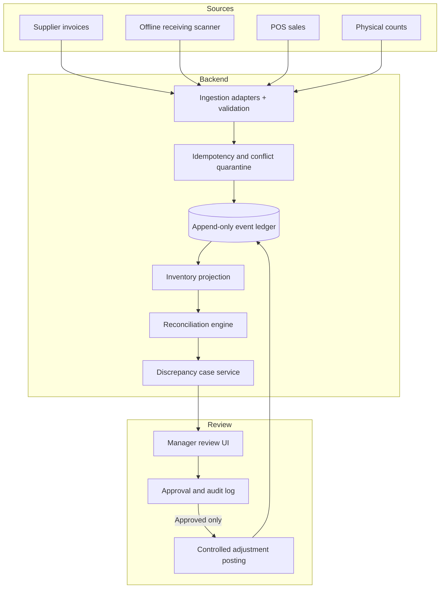
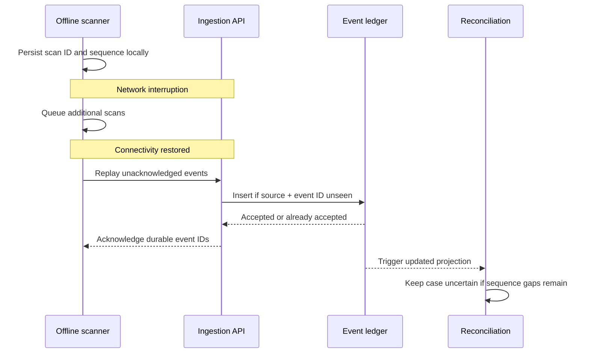
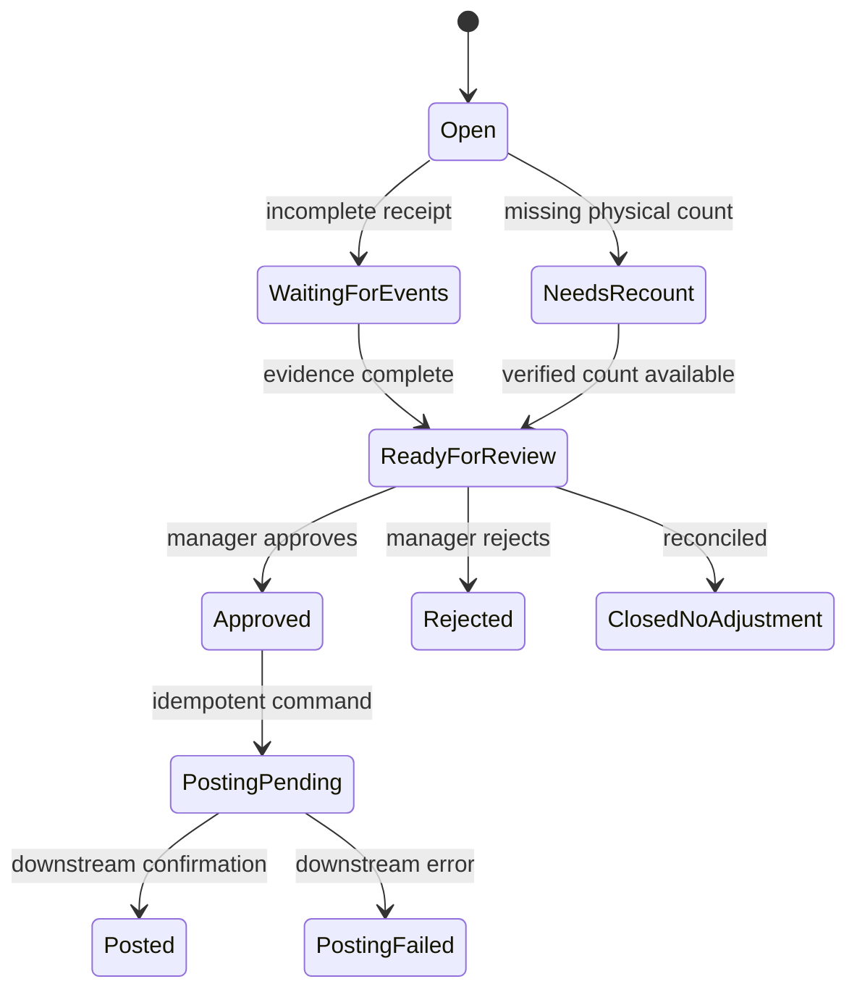

# System design diagrams

These Mermaid diagrams represent the **proposed architecture**, not an implemented deployment.

## Component architecture

## Interrupted scanner replay

## Manager approval

